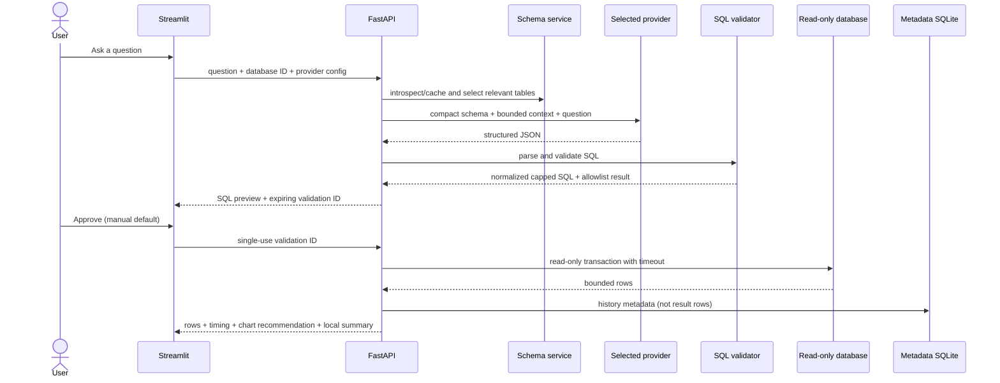

# QueryMind AI architecture

## Design goals

QueryMind separates the browser-facing analytics experience from all trusted operations. Streamlit never connects directly to an analytics database. FastAPI owns provider calls, schema selection, SQL policy, validation state, execution, and metadata persistence.

## Backend layers

### API

`backend/app/api/v1.py` exposes versioned Pydantic-validated routes. Errors are returned as structured messages without Python tracebacks. The service container is initialized in the FastAPI lifespan.

### Database service

The manager keeps live connection URLs only in memory and publishes non-secret connection metadata. SQLAlchemy inspection extracts tables, columns, primary keys, foreign keys, and types. Schema results are cached for five minutes and can be explicitly refreshed.

SQLite files are normalized into read-only URI connections. PostgreSQL connections retain an explicit schema allowlist. The executor also applies a database-specific timeout and always rolls back the transaction.

### LLM service

`LLMProvider` provides a small asynchronous interface. Gemini uses `generateContent`; Groq, OpenRouter, custom endpoints, and Ollama use their OpenAI-compatible chat-completions interfaces. HTTP requests have connection/request deadlines, two bounded transient retries, exponential backoff, and categorized key/quota/model/network errors.

Provider selection is explicit. There is no cross-provider fallback. The UI holds temporary keys in Streamlit session state, while `.env` supports persistent local configuration.

### Schema selection and prompt

The selector scores table and column names against normalized question terms, includes related foreign-key targets, and caps the number of included tables. The prompt contains only:

- SQL dialect;
- selected table/column/type metadata and relationships;
- bounded prior user/assistant turns;
- the current question;
- a compact security and output contract.

The provider must return a Pydantic-validated object containing SQL, explanation, referenced tables, assumptions, clarification state, and a chart suggestion. Confidence percentages are deliberately absent because the application has no calibrated confidence model.

### SQL lifecycle

Generated or manually selected example SQL is parsed by SQLGlot for the target dialect. The validator enforces one SELECT-based statement, checks every referenced base table/schema, inspects qualified columns, rejects unsafe AST nodes/functions/locks/`SELECT INTO`, and wraps the statement with a server-side result cap.

Successful validation creates a random, server-held ticket containing the normalized SQL, database ID, digest, and ten-minute expiry. The client receives only the opaque ID. Execution consumes the ticket, so replay requires revalidation.

### Analytics

Results are converted to JSON-safe values without changing the database. Pandas examines shape and dtypes to recommend a KPI, time-series, categorical, scatter, histogram, or table view. The deterministic summary computes local row counts and numerical statistics. Optional AI insights receive only this local summary, column names, and at most 50 displayed rows.

### Persistence

The local metadata database stores query definitions, outcome/status, timing, row count, provider/model names, and saved queries. Query result rows and credentials are not stored. Generated demo and metadata files are gitignored.

## Conversation and correction

The frontend keeps a bounded conversation. A follow-up sends only the most recent configured turns. Failed executions expose a sanitized database error and can request a corrected SQL proposal at most twice in the UI. The corrected SQL returns to the same validator and manual-approval step; it is never executed directly.

## Extension points

- Add another `LLMProvider` adapter and expose it in the provider factory.
- Add database dialect behavior behind `DatabaseManager` and `QueryExecutor`.
- Add deterministic chart rules without changing execution.
- Replace the in-process ticket store with a TTL-capable store for a multi-process deployment.
