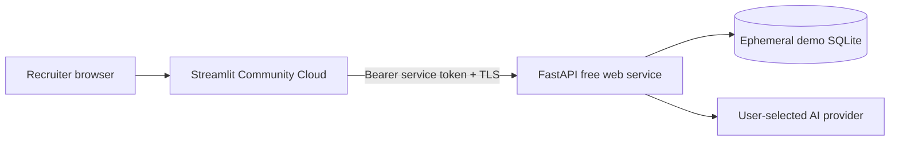

# Deployment readiness plan

## Executive recommendation

Do not publish the current local profile unchanged. For a recruiter-facing, zero-cost demo, expose only the Streamlit UI, keep the FastAPI service authenticated, disable user-added database connections, use only the generated demo database, and require visitors to provide their own AI key if AI generation is enabled.

The safest practical free-tier topology that preserves the existing separation is:

The backend must have `APP_HOST=0.0.0.0` and a long random `QUERYMIND_API_TOKEN`. Streamlit holds the same token in its secret store and sends it server-to-server. QueryMind now refuses a non-loopback backend bind when that token is absent.

This topology is suitable for a limited portfolio demo, not production analytics.

## Streamlit Community Cloud suitability

Community Cloud is suitable for the UI. It runs a repository entrypoint from the repository root, supports a root `requirements.txt`, offers secret configuration, and currently defaults to Python 3.12. Select Python 3.12 explicitly when creating the app. Official documentation recommends pinning Streamlit because unpinned environments may update unexpectedly.

Community Cloud is not a standalone FastAPI host. With the current architecture, FastAPI needs a separate service or a deliberate single-container/internal-process deployment. Do not attempt to expose the FastAPI port through Streamlit.

Published approximate resource limits are variable: roughly 690 MB–2.7 GB memory, up to 2 CPU cores, and up to 50 GB local storage. Apps without traffic for 12 hours hibernate. QueryMind's 1.3 MB demo database is small, but Pandas/Plotly/Streamlit dominate memory, so result rows remain capped at 1,000.

Official references:

- [Community Cloud dependencies](https://docs.streamlit.io/deploy/streamlit-community-cloud/deploy-your-app/app-dependencies)
- [Community Cloud resources and hibernation](https://docs.streamlit.io/deploy/streamlit-community-cloud/manage-your-app)
- [Community Cloud deployment and Python selection](https://docs.streamlit.io/deploy/streamlit-community-cloud/deploy-your-app/deploy)

## FastAPI hosting

A separate free FastAPI web service is required for the recommended Community Cloud topology. Render supports FastAPI web services, but its free services spin down after 15 minutes of inactivity and can take about a minute to wake. Its filesystem is ephemeral: local SQLite history, saved queries, and any runtime files disappear on restart, redeploy, or spin-down.

That means the free deployment should treat QueryMind as a stateless demo:

- regenerate the deterministic demo database at startup;
- do not promise persistent history or saved queries;
- do not accept production database credentials;
- expect cold-start delays and show a useful reconnect message;
- never place provider or database secrets in the repository.

Render's free PostgreSQL offering is time-limited, so it is not a durable zero-cost persistence strategy. Use an independently managed database only after adding per-user authentication, tenant isolation, migrations, backups, and retention controls.

Official references:

- [Render free-service limits](https://render.com/docs/free)
- [Render FastAPI/web-service deployment](https://render.com/docs/your-first-deploy)

## Authentication and API isolation

The shared service token added in Phase 2 prevents anonymous direct calls to `/api/v1/*`; it is sufficient only for a single trusted frontend service. It does not identify individual recruiters or prevent one UI visitor from consuming shared resources.

Before allowing real databases or a server-owned AI key, add:

1. user authentication with short-lived sessions;
2. per-user authorization for every connection and validation ticket;
3. server-side rate limits for generation, correction, validation, and execution;
4. per-user quotas and concurrency limits;
5. a managed secret store and key rotation;
6. TLS-only database connections and strict outbound egress policy;
7. CSRF/session protections appropriate to the chosen identity layer;
8. shared TTL storage for validation tickets when using multiple workers;
9. audit logging that does not retain sensitive result rows;
10. explicit data-retention and provider-processing notices.

Do not put a long-lived backend bearer token in browser JavaScript. Streamlit's Python process may hold it because its calls are server-side.

## Database policy for a public demo

`PUBLIC_DEMO_MODE=true` now hard-disables `/databases/connect`, `/databases/test`, connection deletion, custom provider URLs, Ollama, shared query history, and saved queries. It also hides OpenAPI metadata and rejects every database identifier except `demo`. This prevents visitors from using the service as a network probe or reading another visitor's local metadata. Keep only the deterministic SQLite demo and its fixed allowlist.

If production database support is later enabled:

- use a dedicated tenant-specific read-only account;
- restrict network paths with firewall rules/private networking;
- enforce TLS certificate verification;
- keep statement/row limits and read-only transactions;
- add a database-side workload/resource group where available;
- never let anonymous users submit connection URLs.

## Secret management

- Streamlit: place `BACKEND_URL`, `QUERYMIND_API_TOKEN`, and optional provider configuration in Community Cloud secrets—not in `.env` committed to Git.
- FastAPI host: configure the same token and provider keys in the hosting platform's environment-secret interface.
- Prefer visitor-supplied AI keys for a public portfolio demo to avoid shared-key abuse. Clearly state that the selected provider receives schema context and bounded result samples.
- Rotate the service token after accidental disclosure or collaborator changes.

## Persistence

SQLite is appropriate for deterministic demo input but not durable cloud state on an ephemeral free filesystem. The demo can be recreated safely. History and saved-query persistence are best-effort only unless moved to a durable database.

For a no-cost public portfolio, explicitly label history as session/instance-local. For durable behavior, add a managed PostgreSQL service and migrations; free database plans and retention terms change frequently and must be rechecked before deployment.

## Alternative single-container option

A Docker-capable host can run Streamlit publicly and FastAPI on loopback inside one container, exposing only the Streamlit port. This reduces the API attack surface and avoids a public backend URL, but requires a supervised two-process container, health checks, and platform-specific port routing. It is preferable to an anonymous public FastAPI endpoint, but free container storage is still generally ephemeral.

Do not use `run.py` unchanged for this setup: it opens a browser and assumes two local ports. Add a deployment-only supervisor/entrypoint after selecting a host.

## Readiness checklist

- [x] Localhost is the default bind address.
- [x] Non-loopback FastAPI binds fail closed without `QUERYMIND_API_TOKEN`.
- [x] Streamlit can attach the backend bearer token server-side.
- [x] CORS origins are configurable.
- [x] Queries use single-use validation tickets, read-only execution, timeouts, and row caps.
- [x] `.env`, generated databases, logs, and virtual environments are ignored.
- [x] Public-demo mode disables arbitrary databases, custom/local endpoints, shared history, and saved queries.
- [x] Public-demo mode applies per-session request, LLM-call, and execution limits.
- [x] Public-demo mode uses stricter configurable query-duration and row caps.
- [ ] User identity and per-user authorization.
- [ ] Distributed/persistent rate limiting and abuse controls for multiple workers.
- [ ] Durable shared ticket/history store for multi-worker deployment.
- [ ] Deployment-specific TLS, egress, monitoring, and incident-response configuration.
- [ ] Load test within the chosen platform's current free-tier limits.

## Decision

Streamlit Community Cloud plus an authenticated free FastAPI web service is the easiest portfolio path, with cold starts and non-durable state clearly disclosed. Use `config/public-demo.env.example` as the configuration checklist. Do not connect a real business database or supply a shared paid AI key in that profile. A limited recruiter demo can proceed only after host-level TLS/egress configuration, a deliberate provider quota decision, and a load test; broader or multi-worker use still requires real user identity, authorization, and distributed rate limiting.
